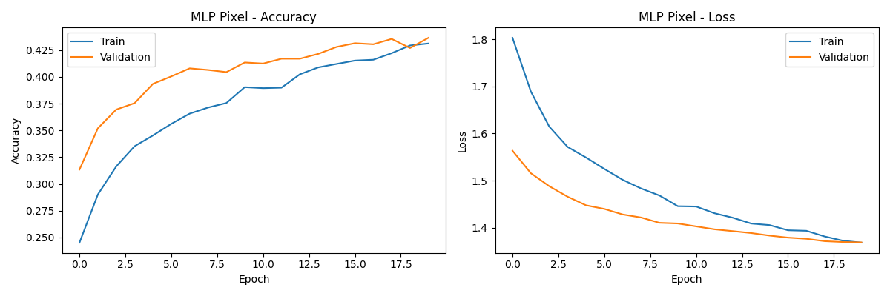
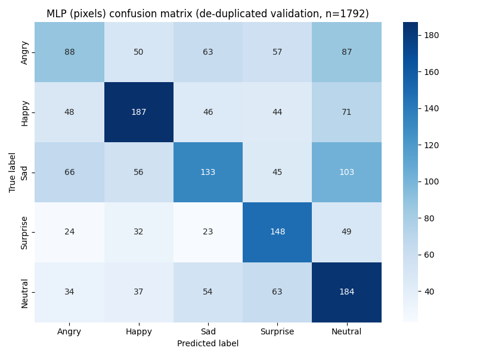
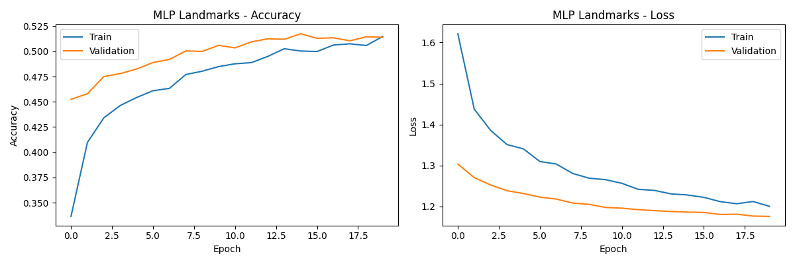
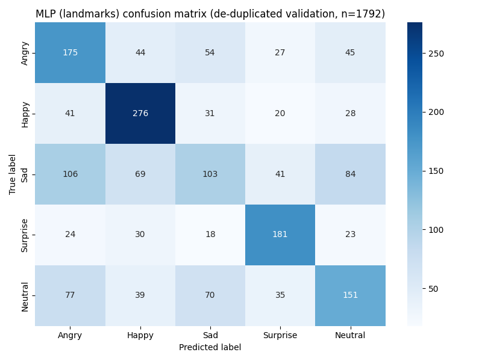
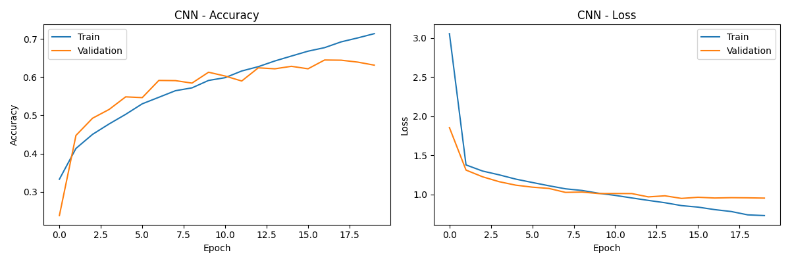
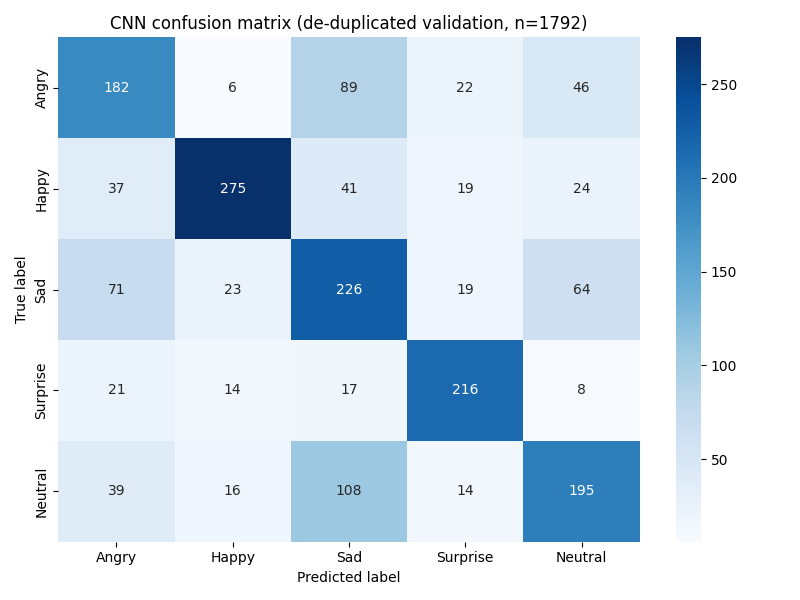
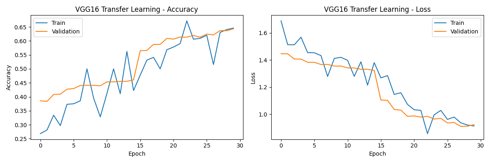
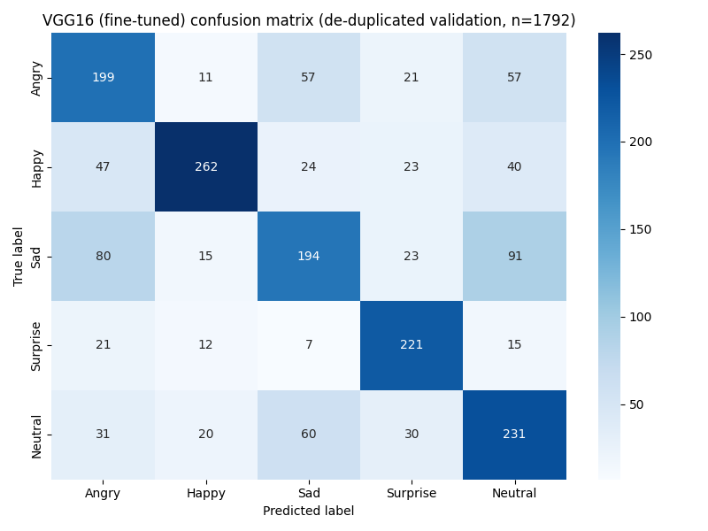
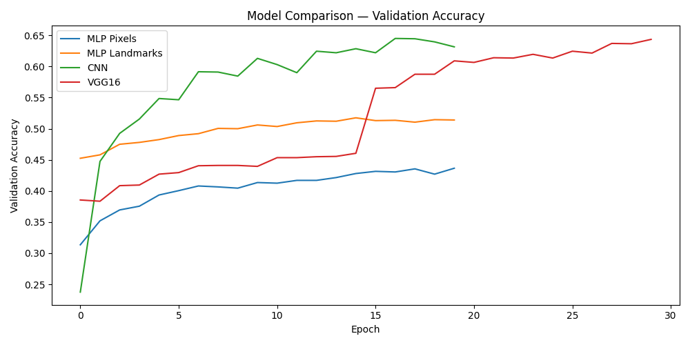

# Emotion Detection with Neural Networks & CNNs

[](https://github.com/pratyushpad/Face-Pulse/actions/workflows/ci.yml)

A deep learning project that classifies **5 facial expressions** from 48x48 grayscale faces, comparing progressively more advanced architectures: a pixel MLP, a facial-landmark MLP, a CNN, and VGG16 transfer learning. The best models reach **about 61% accuracy** on a de-duplicated validation split.

**[Live Demo](https://face-pulse.netlify.app/)**: try it with your webcam. Note: the hosted demo runs face-api.js's pretrained expression model (7 classes) in the browser. The models trained in this repo are served by the self-hostable FastAPI backend described below.

## Emotions Detected (trained models)
Angry · Happy · Sad · Surprise · Neutral

Class index 4 is FER2013 **neutral**, not fear. An earlier version of this README, the backend and the plots called it "Fear". Matching every training image back to its source FER2013 image by pixel distance shows index 4 is neutral for 3,995 of 4,000 rows, so the models have never seen a fear example.

## Results

Measured with `python eval_models.py` (evaluated 2026-10-27). The split is `train_test_split(test_size=0.1, random_state=42)` on the 20,000 training rows.

**De-duplicated validation (headline numbers, n=1,792):** 208 of the 2,000 validation rows are near-copies of training rows (pixel RMSE under 3.5 gray levels, i.e. the same face re-encoded), so they are dropped.

| Model | Accuracy | Macro-F1 | F1 Angry | F1 Happy | F1 Sad | F1 Surprise | F1 Neutral |
|---|---|---|---|---|---|---|---|
| MLP (pixels) | 41.3% | 0.409 | 0.291 | 0.493 | 0.368 | 0.468 | 0.425 |
| MLP (landmarks) | 49.4% | 0.492 | 0.456 | 0.646 | 0.303 | 0.624 | 0.430 |
| CNN | 61.0% | 0.620 | 0.524 | 0.753 | 0.511 | 0.763 | 0.550 |
| **VGG16 (fine-tuned)** | **61.8%** | **0.624** | 0.550 | 0.732 | 0.521 | 0.744 | 0.573 |

**Original leaky validation split (n=2,000, kept for reference):** these were the previously published numbers. They include the 208 duplicated rows, which the CNN gets right 94% of the time, so they overstate accuracy by about 3 points.

| Model | Accuracy | Macro-F1 | F1 Angry | F1 Happy | F1 Sad | F1 Surprise | F1 Neutral |
|---|---|---|---|---|---|---|---|
| MLP (pixels) | 43.6% | 0.430 | 0.306 | 0.490 | 0.370 | 0.564 | 0.418 |
| MLP (landmarks) | 51.7% | 0.507 | 0.468 | 0.633 | 0.304 | 0.699 | 0.433 |
| CNN | 64.5% | 0.647 | 0.559 | 0.757 | 0.523 | 0.836 | 0.558 |
| VGG16 (fine-tuned) | 64.3% | 0.643 | 0.575 | 0.734 | 0.522 | 0.808 | 0.574 |

Caveats:
- The checkpoints were also selected on this validation split (Keras `ModelCheckpoint` on `val_accuracy`), so even the de-duplicated numbers are validation figures, not a fully unseen test set.
- The official FER2013 test split can't be used as-is: about 61% of its images in these 5 classes are already inside the training data. As a cross-check, on the official test images that do not appear in the training data (n=1,988; only 4 classes, because the training subset used essentially every surprise face), the CNN scored 61.8% and VGG16 61.5%. That check needs the Kaggle image folders and a separate pixel-matching script, so it is not part of `eval_models.py`.
- The CNN and VGG16 are effectively tied. Neither clearly beats the other.

## Web App

Real-time webcam emotion detection app:

- **Hosted demo (frontend)**: React + TypeScript + Vite + Tailwind CSS + Framer Motion + Chart.js, deployed on Netlify. It runs fully in the browser with face-api.js's **pretrained** TinyFaceDetector and FaceExpressionNet (7 classes), so it works without a server. It does not run the models trained in this repo.
- **Backend**: FastAPI + OpenCV (Haar cascade face detection) + TensorFlow, a self-hostable API (Dockerfile included) that serves the VGG16 checkpoint trained here and returns the 5 classes above. The hosted demo does not call it.

Frontend features:
- Real-time webcam emotion detection with face bounding box overlay
- Emotion probability bar chart and session timeline
- Session dashboard with breakdown charts
- Detection history

Backend routes: `POST /api/detect` (base64 frame), `POST /api/detect-image` (file upload), `GET /api/health`, `GET /api/model-info`. FastAPI also serves interactive docs at `/docs`.

## Models Built
| Model | Input | Description |
|-------|-------|-------------|
| MLP (Pixels) | Raw pixel values | Fully connected neural network on flattened 48x48 images |
| MLP (Landmarks) | Facial landmark distances | MLP trained on geometric distances between facial keypoints |
| CNN | 48x48 grayscale images | Convolutional network with batch normalization and dropout |
| VGG16 Transfer Learning | 48x48 images | Pretrained ImageNet model with 2-phase fine-tuning (block4 + block5 unfrozen) |

## Dataset
The training arrays (`pureX.npy`, `dataX.npy`, `dataY.npy`) come from the Inspirit AI "AI Scholars" emotion-detection project materials: a 20,000-image subset of [FER2013](https://www.kaggle.com/datasets/msambare/fer2013) with 4,000 faces in each of the 5 classes, plus precomputed facial-landmark distances. `scripts/download_assets.py` fetches them. The full FER2013 image folders on Kaggle are only needed for extra cross-checks.

## Tech Stack

**ML Training:**
- Python 3, TensorFlow / Keras
- NumPy, Pandas, scikit-learn
- OpenCV, dlib (facial landmark extraction)
- Matplotlib, Seaborn

**Web App:**
- React 18 + TypeScript + Vite + Tailwind CSS
- FastAPI + Uvicorn (self-hostable backend, Docker)
- Chart.js, Framer Motion
- Netlify (hosted frontend demo)

## Project Structure
```
emotion-detection-cnn/
│
├── model.py                  # All 4 model definitions + training pipeline
├── eval_models.py            # Evaluate saved checkpoints: results tables (+ --plots)
├── data_prep.py              # Downloads .npy feature data + dlib landmark model
├── scripts/
│   └── download_assets.py    # Fetch datasets and model checkpoints
├── sample_images/            # A few FER2013 test faces (the fear_* ones are outside the 5 trained classes)
│
├── web-app/
│   ├── backend/              # FastAPI server + model inference
│   │   ├── main.py           # API routes (/api/detect, /api/detect-image, /api/health, /api/model-info)
│   │   ├── model_loader.py   # Keras model loading + StandardScaler normalization
│   │   ├── tests/            # pytest suite (runs without TensorFlow)
│   │   └── Dockerfile
│   └── frontend/             # React + TypeScript SPA
│       ├── src/pages/        # Home, Detect, Dashboard, History, About
│       ├── src/components/   # CameraFeed, EmotionDisplay, AnalyticsPanel, etc.
│       └── src/hooks/        # useCamera, useFaceDetection
│
├── pureX.npy                 # Pixel feature data        (via download_assets.py)
├── dataX.npy                 # Landmark distance data    (via download_assets.py)
└── dataY.npy                 # Emotion labels            (via download_assets.py)
```

## How to Run Locally

**1. Clone the repo**
```bash
git clone https://github.com/pratyushpad/Face-Pulse.git
cd Face-Pulse
```

**2. Download data + pretrained models**
```bash
python scripts/download_assets.py --models   # .npy arrays, dlib .dat, .h5 checkpoints
```
(FER2013 train/test image folders, if you want them, come from
[Kaggle](https://www.kaggle.com/datasets/msambare/fer2013): `kaggle datasets download -d msambare/fer2013`.)

**3. Train the models** (optional; pretrained checkpoints available via step 2)
```bash
pip install tensorflow numpy pandas scikit-learn opencv-python matplotlib seaborn dlib
python model.py
```

**4. Evaluate the checkpoints**
```bash
python eval_models.py           # prints both results tables above
python eval_models.py --plots   # also redraws the confusion matrices
```

**5. Run the web app**
```bash
# Backend
cd web-app/backend
pip install -r requirements.txt
uvicorn main:app --reload

# Frontend (new terminal)
cd web-app/frontend
npm install
npm run dev
```

Open `http://localhost:5174` in your browser.

## Key Takeaways
- The CNN and the fine-tuned VGG16 land within 1 point of each other on de-duplicated validation (61.0% vs 61.8%)
- About 10% of the validation rows were near-duplicates of training rows; removing them cost about 3 points of accuracy
- StandardScaler normalization matched between training and inference for consistent predictions
- Data augmentation (rotation, shifts, flips, zoom) to combat FER2013 label noise

## What I Learned
- Flattening images into vectors loses all spatial information, which is why my MLP on raw pixels performed the worst
- Two-phase fine-tuning made a huge difference: freezing VGG16 first, then unfreezing the last 2 blocks with a 10x lower LR to avoid blowing away the pretrained weights
- FER2013 labels are noisy (some images are mislabeled); data augmentation helped the model generalize instead of memorizing bad labels
- Getting training normalization to match inference normalization was a pain: I had to export the StandardScaler params to JSON and load them in the backend
- Output-index order matters: the class order in `dataY.npy` isn't alphabetical. Checking the trained models against labeled test images fixed the first four labels but left the fifth wrong ("Fear" instead of Neutral). Matching the training pixels back to their source FER2013 images settled it. Verify the label mapping against the data itself, not just model behavior
- Check for duplicates between train and validation before trusting a number: FER2013 contains repeated faces, and a random split puts some copies on both sides
- Packaging a TensorFlow backend in Docker means thinking about model file size (~157MB) and cold-start time up front
- Canvas overlay rendering at 60fps while simultaneously capturing frames for inference every 500ms meant being careful with requestAnimationFrame vs setInterval

## Author
Pratyush Padhy, UCI CS '28
[GitHub](https://github.com/pratyushpad) · [LinkedIn](https://www.linkedin.com/in/pratyushpad)

## Training Curves & Confusion Matrices

Training curves were recorded during training on the full (leaky) validation split. Confusion matrices are on the de-duplicated validation split (`python eval_models.py --plots`).

### MLP (Pixel Inputs)



### MLP (Landmark Inputs)



### CNN



### VGG16 Transfer Learning



### Model Comparison

